# DevOps Engineer Assessment - Cloud-Native Web Service & Observability Platform

**Developer:** MD. AL-AMIN  
**Email:** amin252646@gmail.com  
**GitHub:** [@MDALAMIN2526](https://github.com/MDALAMIN2526)  
**Repository:** [DevOps-Engineer-Assessment](https://github.com/MDALAMIN2526/DevOps-Engineer-Assessment)

[](.github/workflows)
[](app)
[](#container-image-details)
[](k8s)
[](terraform)
[](monitoring)

---

## Table of Contents

1. [Architecture Overview](#1-architecture-overview)
2. [Prerequisites & Quick Start](#2-prerequisites--quick-start)
3. [Step-by-Step Implementation & Testing Guide](#3-step-by-step-implementation--testing-guide)
   - [Step 1: Application & Containerization](#step-1-application--containerization)
   - [Step 2: CI/CD Pipeline (GitHub Actions)](#step-2-cicd-pipeline-github-actions)
   - [Step 3: Infrastructure as Code (Terraform)](#step-3-infrastructure-as-code-terraform)
   - [Step 4: Kubernetes Deployment & Rollout](#step-4-kubernetes-deployment--rollout)
   - [Step 5: Observability Stack (6 Mandatory Components)](#step-5-observability-stack)
   - [Step 6: Linux Automation Scripting (`system_health.sh`)](#step-6-linux-automation-scripting)
4. [Design Decisions & Trade-Offs](#4-design-decisions--trade-offs)
5. [Deployment & Rollback Strategy](#5-deployment--rollback-strategy)
6. [Security Considerations](#6-security-considerations)
7. [Observability Incident Walkthrough](#7-observability-incident-walkthrough)
8. [Rough Monthly AWS Cost Estimate](#8-rough-monthly-aws-cost-estimate)
9. [What I Would Improve With More Time](#9-what-i-would-improve-with-more-time)
10. [Note on AI Tools Usage](#10-note-on-ai-tools-usage)

---

## 1. Architecture Overview

### End-to-End Delivery & Infrastructure Flow

```mermaid
flowchart TD
    subgraph CI_CD["GitHub Actions CI/CD Pipeline"]
        PR[Developer Pull Request] --> Lint[Code & Script Linting\ngo fmt, hadolint, shellcheck]
        Lint --> Tests[Unit Tests & Coverage\ngo test -race -cover]
        Tests --> Scan[Vulnerability Gate\nTrivy Scanner - Fail on CRITICAL]
        Scan --> Merge[Merge to main]
        Merge --> BuildMultiArch[Buildx Multi-Arch\namd64 & arm64]
        BuildMultiArch --> PushRegistry[Container Registry\nGHCR / Amazon ECR]
        PushRegistry --> DeployEC2[Deploy to AWS EC2\nvia SSH / SSM]
        DeployEC2 --> SmokeTest{Smoke Test\nGET /health}
        SmokeTest -->|Healthy| Success[Live in Production]
        SmokeTest -->|Failed| AutoRollback[Auto Rollback to Previous Image]
    end

    subgraph AWS_INFRA["AWS Infrastructure (Terraform)"]
        VPC[Default VPC / Subnet]
        SG[Security Group\nPorts 8080 & 22]
        EC2[EC2 Instance\nUbuntu 24.04 LTS]
        IAM[IAM Role Profile\nLeast Privilege]
        CW[CloudWatch Log Group\n14-Day Retention]
        
        VPC --> SG --> EC2
        EC2 -.->|Instance Profile| IAM
        EC2 -->|Container Logs| CW
    end

    subgraph OBSERVABILITY["Observability Platform (Docker Compose)"]
        APP[DevOps Web Service\n:8080]
        NE[Node Exporter\n:9100 Host Stats]
        CAD[cAdvisor\n:8080 Container Stats]
        PROM[Prometheus\n15-Day TSDB]
        ALLOY[Grafana Alloy\nDocker Log Discovery]
        LOKI[Grafana Loki\n168h Log Retention]
        GRAF[Grafana :3001\nProvisioned Dashboards]

        APP -->|/metrics| PROM
        NE -->|/metrics| PROM
        CAD -->|/metrics| PROM
        APP -->|JSON stdout| ALLOY
        ALLOY -->|Parsed Log Streams| LOKI
        PROM -->|Metrics Data Source| GRAF
        LOKI -->|Logs Data Source| GRAF
    end
```



---

## 2. Prerequisites & Quick Start

### Prerequisites
- Docker Engine (v24.0+) & Docker Compose (v2.20+)
- Go (v1.23+) *(for running tests locally without container)*
- Terraform (v1.5+) *(for AWS deployment)*
- kubectl (v1.28+) *(for Kubernetes deployment)*

### 1-Minute Local Launch
To spin up both the application and the complete observability stack:

```bash
# 1. Clone repository
git clone https://github.com/MDALAMIN2526/DevOps-Engineer-Assessment.git
cd DevOps-Engineer-Assessment

# 2. Start application container (Port 8080)
docker compose up -d --build

# 3. Start observability stack (Prometheus, Grafana, Loki, Alloy, Node Exporter, cAdvisor)
docker compose -f docker-compose.monitoring.yml up -d

# 4. Check status of running containers
docker compose ps
docker compose -f docker-compose.monitoring.yml ps
```

### Accessing Endpoints & Dashboards

| Service | Host URL | Description | Default Credentials |
| :--- | :--- | :--- | :--- |
| **Application Root** | `http://localhost:8080/` | Main JSON endpoint | None |
| **Health Probe** | `http://localhost:8080/health` | Liveness & readiness check | None |
| **Prometheus Metrics** | `http://localhost:8080/metrics` | Prometheus metrics scrape target | None |
| **Grafana UI** | `http://localhost:3001` | Pre-provisioned dashboards | `admin` / `admin123` |
| **Prometheus API** | *Internal Network* | Scrapes metrics every 10s | None |
| **Loki API** | *Internal Network* | Centralized log ingestion | None |

---

## 3. Step-by-Step Implementation & Testing Guide

### Step 1: Application & Containerization

I built the service in **Go 1.23** using the standard library `net/http` and the official `prometheus/client_golang` package. This avoids third-party web framework dependencies and keeps runtime memory usage under 15MB.

- **Endpoints**:
  - `GET /`: Returns JSON greeting:
    ```json
    {"message":"Hello from DevOps Task!","status":"running","version":"1.0.0"}
    ```
  - `GET /health`: Returns JSON health status, uptime, environment, and version with HTTP 200.
  - `GET /metrics`: Exposes Go runtime metrics along with custom application metrics:
    - `http_requests_total{method, path, status}` (Counter)
    - `http_errors_total{method, path, status}` (Counter for status >= 400)
    - `http_request_duration_seconds{method, path}` (Histogram)
- **Configuration**: Read strictly from environment variables:
  - `PORT`: Listen port (default: `8080`).
  - `LOG_LEVEL`: Verbosity (`DEBUG`, `INFO`, `WARN`, `ERROR`).
  - `ENVIRONMENT`: Deployment stage (`development`, `staging`, `production`).
  - `APP_VERSION`: Semantic version string (default: `1.0.0`).
- **Structured Logging**: Emits JSON structured logs directly to `stdout` using Go's `log/slog`.
- **Graceful Shutdown**: Catches `SIGINT` and `SIGTERM` signals, completing pending requests within a 10-second timeout context.

#### Container Image Details
- **Multi-stage Dockerfile**:
  - Builder: `golang:1.23.6-alpine3.21` (pinned)
  - Runner: `alpine:3.21.3` (pinned)
- **Security**: Runs under non-root user `appuser` (UID/GID `10001:10001`).
- **Healthcheck**: Uses native `wget --no-verbose --tries=1 --spider http://127.0.0.1:8080/health`.
- **Final Image Size**: **7.08 MB** *(measured via `docker image inspect`)*.

#### Running Unit Tests
```bash
cd app
go test -v -race -covermode=atomic -coverprofile=coverage.out ./...
go tool cover -func=coverage.out
```

---

### Step 2: CI/CD Pipeline (GitHub Actions)

I implemented two GitHub Actions workflows under `.github/workflows/`:

#### 1. Pull Request Verification (`pr.yml`)
Runs on every PR to `main`:
- **Code Lint & Format**: Enforces standard `gofmt` and `go vet`.
- **Unit Tests & Race Detection**: Runs unit tests with race detection and outputs coverage reports.
- **Dockerfile Linting**: Runs `hadolint/hadolint-action@v3.1.0` with a zero-warning policy.
- **Shell Script Linting**: Runs `shellcheck` across all shell scripts.
- **Vulnerability Scanner**: Builds the local image and runs `aquasecurity/trivy-action@0.28.0`. **Pipeline fails on any CRITICAL vulnerability.**

#### 2. Release & Deployment Pipeline (`deploy.yml`)
Runs on push to `main`:
- **Multi-Arch Build**: Uses Docker Buildx and QEMU to build for both `linux/amd64` and `linux/arm64`.
- **Caching**: Uses GitHub Actions Cache (`type=gha,mode=max`) for layer caching.
- **Tagging**:
  - Commit SHA: `ghcr.io/<repo>:sha-<short-sha>`
  - Semantic Run: `ghcr.io/<repo>:v1.0.<run_number>`
  - Mutable tag: `ghcr.io/<repo>:latest`
- **EC2 Deployment with Automatic Rollback**:
  - Pulls the newly tagged image to the EC2 target instance.
  - Records the previous running container image ID.
  - Launches the new container.
  - Runs smoke tests against `http://127.0.0.1:8080/health` (10 retries).
  - **Automated Rollback**: If the smoke test fails, the trap handler executes immediately, restoring the previous stable image.

---

### Step 3: Infrastructure as Code (Terraform)

Located in `terraform/`, the code provisions an AWS deployment target following least-privilege principles.

- **VPC & Security Group**: Exposes only port `8080` (HTTP) and port `22` (restricted SSH).
- **IAM Instance Profile**:
  - Read permissions for Amazon ECR (`ecr:GetAuthorizationToken`, `ecr:BatchGetImage`, etc.).
  - Scoped CloudWatch Logs write access (`logs:CreateLogStream`, `logs:PutLogEvents`).
  - No static credentials anywhere.
- **EC2 Instance**: Free Tier eligible `t3.micro` running Ubuntu 24.04 LTS with an encrypted 20GB gp3 root volume.
- **Bootstrap Script (`userdata.sh`)**: Installs Docker CE and runs the container using the native AWS CloudWatch logging driver (`--log-driver=awslogs`).
- **CloudWatch Logs**: Log group `/aws/ec2/<env>-devops-assessment-app` with defined retention (14 days staging, 30 days production).
- **Remote State**: S3 backend configuration with DynamoDB state locking in `backend.tf`.

#### Running Terraform
```bash
cd terraform

# 1. Initialize providers
terraform init -backend=false

# 2. Validate configuration
terraform validate

# 3. Plan for Staging
terraform plan -var-file="environments/staging.tfvars"

# 4. Plan for Production
terraform plan -var-file="environments/production.tfvars"

# 5. Clean up resources
terraform destroy -var-file="environments/staging.tfvars"
```

---

### Step 4: Kubernetes Deployment & Rollout

Kubernetes manifests are organized under `k8s/` using **Kustomize** with base manifests and staging/production overlays.

- **Deployment**:
  - Replicas: 2 (base/staging), 3 (production).
  - Rolling update: `maxSurge: 1`, `maxUnavailable: 0` (zero downtime).
  - Health checks: Liveness and Readiness probes configured on `/health`.
  - Resource limits: Requests `50m CPU / 64Mi Memory`, Limits `200m CPU / 128Mi Memory`.
  - `securityContext`: `runAsNonRoot: true`, `runAsUser: 10001`, `readOnlyRootFilesystem: true`, `capabilities.drop: ["ALL"]`.
- **ConfigMap & Secret**:
  - `app-config`: Application configuration.
  - `app-secret`: Sensitive credentials template (documented for External Secrets Operator / SOPS).
- **Networking**: ClusterIP Service and Nginx Ingress manifest.
- **Autoscaling (HPA)**: Scales from 2 to 5 pods when CPU utilization exceeds 70%.

#### Rendering Manifests
```bash
# Render Base
kubectl kustomize k8s/base

# Render Staging Overlay
kubectl kustomize k8s/overlays/staging

# Render Production Overlay
kubectl kustomize k8s/overlays/production
```

#### Zero-Downtime Rolling Update & Rollback Demonstration
```bash
# 1. Apply deployment
kubectl apply -k k8s/overlays/staging

# 2. Trigger rolling update
kubectl set image deployment/devops-assessment-app app=ghcr.io/mdalamin2526/devops-engineer-assessment:v1.1.0 --record

# 3. Monitor rollout
kubectl rollout status deployment/devops-assessment-app
# Output:
# Waiting for deployment "devops-assessment-app" rollout to finish: 1 out of 2 new replicas have been updated...
# deployment "devops-assessment-app" successfully rolled out

# 4. View history
kubectl rollout history deployment/devops-assessment-app

# 5. Rollback to previous version
kubectl rollout undo deployment/devops-assessment-app
# Output:
# deployment.apps/devops-assessment-app rolled back

# 6. Verify rollback
kubectl rollout status deployment/devops-assessment-app
# Output:
# deployment "devops-assessment-app" successfully rolled out
```

#### Production Considerations on Amazon EKS
When moving from local Kubernetes (Kind/k3d) to Amazon EKS in production:
1. **AWS Load Balancer Controller (ALBC)**: Replace Nginx Ingress with ALBC provisioning an Application Load Balancer (ALB) via `ingressClassName: alb`.
2. **Secrets Management**: Deploy **External Secrets Operator (ESO)** to sync credentials from AWS Secrets Manager directly into Kubernetes secrets.
3. **Node Autoscaling**: Deploy **Karpenter** to provision and de-provision EC2 worker nodes just-in-time based on pending pod requests.
4. **IAM Roles for Service Accounts (IRSA)**: Connect Kubernetes ServiceAccounts to AWS IAM Roles via EKS OIDC, eliminating static credentials.

---

### Step 5: Observability Stack

The monitoring platform is defined in `docker-compose.monitoring.yml` with **all 6 mandatory components**:

1. **Prometheus (`v2.54.1`)**: Scrapes the app, Node Exporter, and cAdvisor with `--storage.tsdb.retention.time=15d`.
2. **Grafana Loki (`3.2.1`)**: Log aggregation with `retention_period: 168h` (7 days) and compactor enabled.
3. **Grafana Alloy (`v1.4.3`)**: Discovers Docker containers via `/var/run/docker.sock`, parses JSON logs, and ships them to Loki. Keeps cardinality low by indexing only `service` and `level`.
4. **Node Exporter (`v1.8.2`)**: Gathers host CPU, memory, disk, and network stats via read-only mounts of `/proc`, `/sys`, and `/`.
5. **cAdvisor (`v0.49.1`)**: Collects container CPU, memory, and memory limits via `/sys` and `/var/run/docker.sock`.
6. **Grafana (`11.2.0`)**: UI exposed on `http://localhost:3001`. Data sources and 3 dashboards are provisioned as code.

#### Pre-Configured Dashboards (`monitoring/grafana/dashboards/`)
1. **Application Dashboard** (`application.json`):
   - Request Rate (QPS by path and method)
   - Error Rate (%)
   - Latency Percentiles (p50, p95, p99)
   - **Correlated Loki Logs Panel**: Displays live application JSON logs directly below metrics.
2. **Host Dashboard** (`host.json`):
   - CPU Utilization (%)
   - Memory Usage & Swap (%)
   - Disk Space Utilization (%)
   - Network Throughput (Rx / Tx Bps)
3. **Containers Dashboard** (`containers.json`):
   - Per-Container CPU Usage
   - Container Working Set Memory
   - Container Memory vs Configured Limit (`% of limit`)

#### Alerting Rules (`monitoring/prometheus/alerts.yml`)

| Alert Name | Metric Expression | Threshold | Duration | Justification |
| :--- | :--- | :--- | :--- | :--- |
| **`AppDown`** | `up{job="devops-app"} == 0` | Target down | `1m` | 1 minute allows quick recovery from transient container restarts while catching genuine downtime. |
| **`AppHighErrorRate`** | `http_errors_total / http_requests_total` | `> 5%` | `2m` | 5% threshold ignores isolated 404 client errors while catching application exceptions. |
| **`HostDiskUsageHigh`** | `(size - free) / size * 100` | `> 80%` | `5m` | Gives engineers time to rotate logs or resize EBS volumes before the disk fills. |
| **`ContainerMemoryHigh`** | `working_set / spec_memory_limit` | `> 85%` | `2m` | Warns before the Linux OOM-killer abruptly terminates the container process. |

---

### Step 6: Linux Automation Scripting

The script [`scripts/system_health.sh`](scripts/system_health.sh) is written for running on Linux servers and automated cron/systemd jobs.

#### Features
- **Strict Execution**: Uses `set -euo pipefail` and passes `shellcheck` with 0 warnings.
- **Metric Collection**: CPU usage, memory usage, disk usage across mounted filesystems, 1m/5m/15m load averages, and top 5 processes by memory.
- **Configurable Flags**:
  - `--disk <num>`: Custom disk warning percentage (default: `80%`).
  - `--cpu <num>`: Custom CPU warning percentage (default: `90%`).
  - `--mem <num>`: Custom memory warning percentage (default: `85%`).
  - `--log <path>`: Destination log file (default: `health_log.txt`).
  - `--json`: Outputs structured JSON log format.
- **Exit Codes**:
  - `0`: Healthy (all metrics within threshold).
  - `1`: Warning (metric exceeded warning threshold).
  - `2`: Critical (severe breach, e.g. disk/memory >= 95%).
- **Log Rotation**: Automatically rotates `health_log.txt` when it exceeds 1 MB, keeping the 3 most recent backups.
- **Webhook Alerting (Bonus)**: Sends webhook POST payloads to Slack or Discord if `ALERT_WEBHOOK_URL` is set.

#### Execution Examples
```bash
# Display help and options
./scripts/system_health.sh --help

# Run in standard human-readable format
./scripts/system_health.sh

# Run with custom thresholds in JSON format
./scripts/system_health.sh --json --disk 90 --cpu 95 --mem 90
```

#### Automated Scheduling (Systemd & Cron)
- **Systemd Timer (Recommended)**: Unit files provided in `scripts/system_health.service` and `scripts/system_health.timer`:
  ```bash
  sudo cp scripts/system_health.service scripts/system_health.timer /etc/systemd/system/
  sudo systemctl daemon-reload
  sudo systemctl enable --now system_health.timer
  ```
- **Cron Alternative**:
  ```bash
  */5 * * * * /opt/devops-assessment/scripts/system_health.sh --json --log /var/log/system_health.log >> /var/log/system_health_cron.log 2>&1
  ```

---

## 4. Design Decisions & Trade-Offs

### 1. Distroless vs. Alpine
- **Choice**: I selected **Alpine 3.21.3** as the final base image.
- **Reasoning**: While Distroless is slightly smaller, it lacks basic utilities like `wget` or `curl`. That prevents native Docker `HEALTHCHECK` and container liveness probes without baking additional binaries into the image. Alpine provides the required POSIX runtime and busybox utilities while keeping the final container image under **7.08 MB**.

### 2. EC2 vs. ECS vs. EKS
- **EC2**: Best for a simple single-service deployment with predictable cost, but requires OS management and patching.
- **ECS (Fargate)**: Great for running containers without managing VMs, but has less flexibility in host-level metrics collection.
- **EKS**: The standard choice for scalable multi-tier architectures, offering native rolling updates, HPA, and GitOps integration, though with a baseline control-plane cost ($73/month).

### 3. Image Tagging Strategy
- I avoid relying on `:latest` in production because it leads to non-deterministic deployments and complicates rollbacks.
- I tag every image with both the **git commit SHA** (`sha-a1b2c3d`) and a **semantic release tag** (`v1.0.X`), ensuring every deployed container can be traced directly to an exact commit.

### 4. Log Label Choices in Grafana Alloy
- **Choice**: Only `service` and `level` are indexed as stream labels.
- **Reasoning**: In Loki, indexing high-cardinality fields (like `path`, `remote_ip`, or `status`) causes stream explosion and degrades query performance. By keeping stream labels bounded and extracting `path` and `status` via JSON parsing at query time, we maintain optimal indexing efficiency.

---

## 5. Deployment & Rollback Strategy

### How a Release Reaches Production Safely
1. **Pull Request**: Code is submitted via PR.
2. **Automated Verification**: GitHub Actions runs linters, unit tests with race detection, and Trivy security scans.
3. **Multi-Arch Build**: Once merged into `main`, GitHub Actions builds AMD64 and ARM64 images and pushes them to GHCR.
4. **Deploy to Target**: The EC2 server pulls the newly tagged image.
5. **Smoke Test**: The deployment script polls `GET /health` up to 10 times.
6. **Automatic Rollback**: If the smoke test fails or times out, the deployment script immediately re-launches the prior image tag, preventing customer downtime.

---

## 6. Security Considerations

- **Non-Root Execution**: Container runs under user `appuser` (UID `10001`).
- **Read-Only Root Filesystem**: Kubernetes manifests set `readOnlyRootFilesystem: true`, restricting writes strictly to `emptyDir` mounts on `/tmp`.
- **Dropped Capabilities**: All standard Linux capabilities are dropped (`drop: ["ALL"]`) with `allowPrivilegeEscalation: false`.
- **Zero Static Credentials**: EC2 instances authenticate via IAM instance profiles; CI/CD workflows use GitHub OIDC.
- **Resource Limits**: Strict CPU and memory requests/limits prevent resource exhaustion and noisy neighbor issues.
- **Host Resource Access for Observability**:
  - `Node Exporter` requires read-only mounts of `/proc`, `/sys`, and `/` to report host CPU, memory, and filesystem statistics.
  - `cAdvisor` requires read access to `/var/run/docker.sock` and `/sys` to inspect cgroup resource consumption. Both containers run in an isolated internal Docker bridge network without public exposure.

---

## 7. Observability Incident Walkthrough

> **Scenario**: An error spike appears on the Application dashboard. How do you find the cause using these tools?

1. **Detection (Application Dashboard)**:
   - Notice the **Error Rate (%)** panel crossing the 5% threshold.
   - Check the **Latency Percentiles** panel to see whether the error spike coincides with a p99 latency spike (suggesting database connection timeouts) or instant 500s (suggesting application panic).
2. **Path Identification (QPS Panel)**:
   - Check the **Request Rate (QPS)** legend to isolate which specific endpoint (e.g. `GET /health` or `GET /`) is producing non-200 status codes.
3. **Log Correlation (Embedded Loki Panel)**:
   - Scroll down to the integrated **Live Application Structured Logs** panel on the same dashboard.
   - Filter logs: `{service="devops-assessment-service", level="ERROR"} | json`.
   - Inspect the stack trace, error message, and associated `remote_ip`.
4. **Container Resource Check (Containers Dashboard)**:
   - Check the **Containers Dashboard** to see if the container's working set memory reached its 128MB limit (`% of limit` > 85%), indicating an OOM event.
5. **Host Sanity Check (Host Dashboard)**:
   - Confirm whether host CPU utilization or root disk capacity caused process degradation.

---

## 8. Rough Monthly AWS Cost Estimate

Estimated monthly cost for running this workload in AWS:

| Service / Resource | Specification | Monthly Estimate (USD) |
| :--- | :--- | :--- |
| **AWS EC2 Compute** | 1x `t3.micro` instance (2 vCPU, 1GB RAM) | $7.49 *(Free Tier eligible)* |
| **EBS Storage** | 20 GB gp3 general purpose SSD volume | $1.60 |
| **CloudWatch Logs** | 2 GB ingestion & storage (14-day retention) | $1.10 |
| **Amazon ECR** | Container storage (< 1 GB) & data transfer | $0.20 |
| **Terraform State** | Amazon S3 storage + DynamoDB state locking | $0.15 |
| **Total Estimated Cost** | **Standard Usage** | **~$10.54 / month** |
| **AWS Free Tier** | First 12 months with AWS Free Tier | **$0.00 / month** |

---

## 9. What I Would Improve With More Time

1. **GitOps with ArgoCD**: Setup ArgoCD to automatically sync Kubernetes manifests from Git to cluster.
2. **Distributed Tracing**: Add OpenTelemetry instrumentation to trace requests end-to-end with **Grafana Tempo**.
3. **Alertmanager Integration**: Configure Alertmanager with routing to Slack or PagerDuty for on-call notification.
4. **Secret Management with Vault / SOPS**: Use HashiCorp Vault or SOPS for encrypting sensitive values in Git.
5. **Canary Deployments**: Use **Flagger** with an Ingress controller for automated canary releases and traffic shifting.

---

## 10. Note on AI Tools Usage

During this assessment, I used **Google Antigravity (Gemini)** as an interactive AI pair-programming assistant in my IDE, alongside official documentation (Go standard library docs, Prometheus client docs, and HashiCorp Terraform registry).

Specifically, I leveraged the AI assistant for:
- Accelerating the scaffolding of boilerplate configs (Kubernetes Kustomize base templates, Terraform resource structures, and Grafana dashboard JSON definitions).
- Reviewing Dockerfile best practices and static analysis compliance (Hadolint and ShellCheck rules).
- Brainstorming edge-case handling for the Linux health automation script and log rotation.

All architectural decisions, Go microservice implementation, Prometheus metrics queries and alerting thresholds, security hardening policies (non-root execution, read-only root filesystems, IAM least-privilege access), and end-to-end testing were personally directed, reviewed, and validated by me. I am fully confident in explaining and discussing every component, trade-off, and line of code submitted in this assessment.
